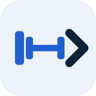

# FitNext

Workouts and food in one app. Log a lift, log a lunch, and see both on the
same Today screen. It runs on a phone, on a Windows PC, or on both with one
shared log.

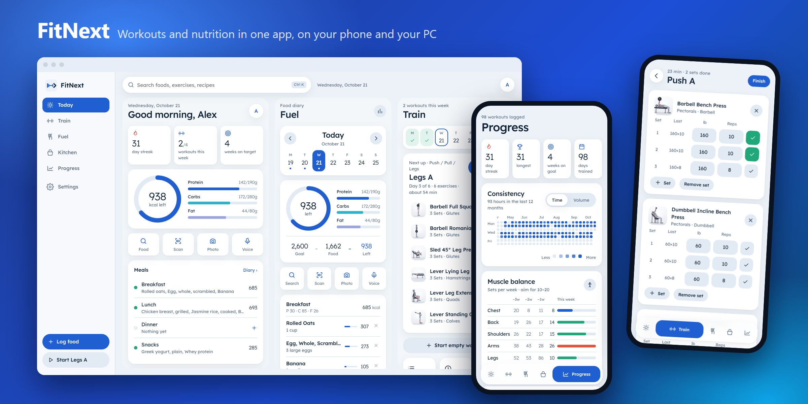

**Try it on a phone now:** https://fitnext-one.vercel.app

## Install

Pick the setup you want. Nothing here needs an account unless you want sync.

### Phone only

No app store, no download. FitNext is a web app that installs to the Home
Screen and works offline after the first visit.

1. Open **https://fitnext-one.vercel.app** on the phone.
2. Add it to the Home Screen:
   - **iPhone (Safari):** tap Share, then **Add to Home Screen**.
   - **Android (Chrome):** tap ⋮, then **Add to Home screen** or **Install app**.
3. Open FitNext from its new icon. It opens full screen, without the browser bar.

Your log stays on the phone. Clearing Safari or Chrome site data clears it
too, so turn on sync (below) if you want a copy somewhere else.

### PC only (Windows)

1. Download `FitNext-Setup-<version>.exe` from the
   [latest release](https://github.com/GoodTimesPM/fitnext/releases/latest).
2. Run it. It installs for your account only, so no administrator prompt, and
   adds Start menu and desktop shortcuts.
3. Windows SmartScreen may say "Windows protected your PC" because the
   installer isn't signed with a paid certificate. Click **More info**, then
   **Run anyway**.

The app updates itself: it checks this repo's releases on start and installs
a new version when you quit. Your data lives in `%APPDATA%\FitNext` and
survives updates and reinstalls.

On a wide window (1180 px and up) each section shows two or three panels side
by side, with a Ctrl+K search over foods, exercises, routines and recipes.

### Both, with one log

1. Install on the phone and on the PC as above.
2. On each device, open **Settings > Sync** and enter the same email.
3. Supabase sends a "Sign in" email. **Copy the link, don't open it**, and
   paste it into the box in FitNext. (Opening it signs in the browser, not the
   app.) If the email shows a 6-digit code, type that instead.
4. Press **Sync now** on either device whenever you want them to match.

Devices merge rather than overwrite. Workouts, diary entries, recipes and
lists combine, a delete on one device carries to the other, and the newest
settings win.

## What's in it

| | |
| --- | --- |
| 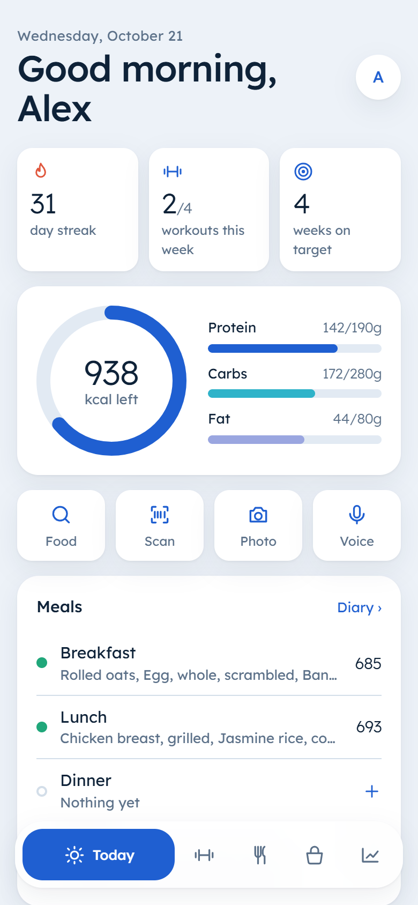 | **Today.** Calories left, macros, today's meals, one-tap logging, your next session, water, weight trend, and day and week streaks. |
| 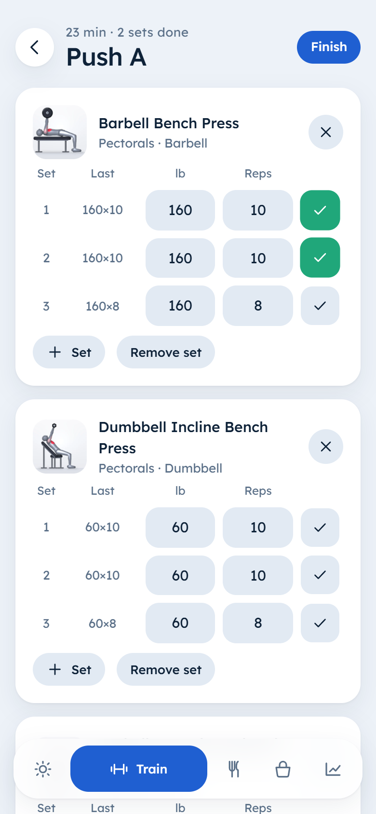 | **Train.** 12 programs (push/pull/legs, upper/lower, 5x5, home, kettlebell and more), your own routines, a guided workout with last-time numbers and a rest timer, history and personal records. |
| 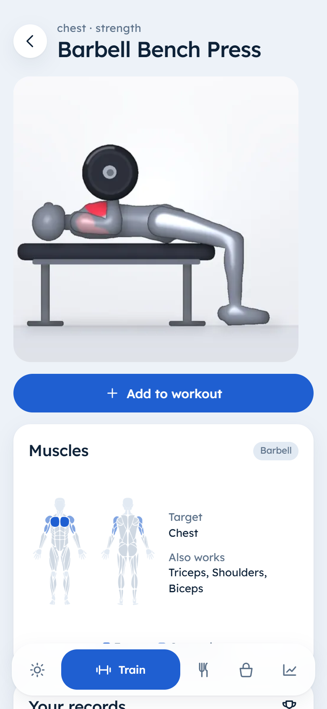 | **5,632 exercises, 1,394 animated.** Filter by body part, equipment and muscle. Each one shows the muscles it works on a body map. |
| 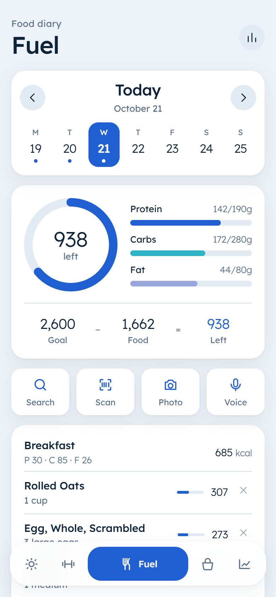 | **Fuel.** One search across Open Food Facts, USDA, FatSecret and Edamam, best match first. Everyday units (1 egg, 1 slice, 1 cup) next to grams. Barcode scan, and photo and voice logging. Micronutrients too. |
| 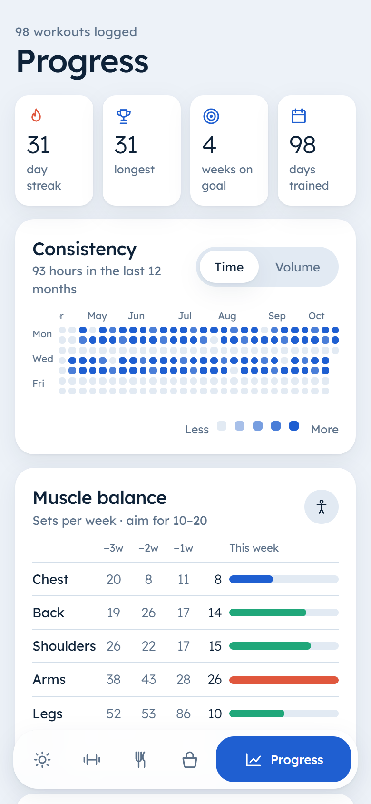 | **Progress.** A 12-month consistency map, weekly sets per muscle against a 10 to 20 target, weekly volume, body weight, body fat and six measurements. |
| 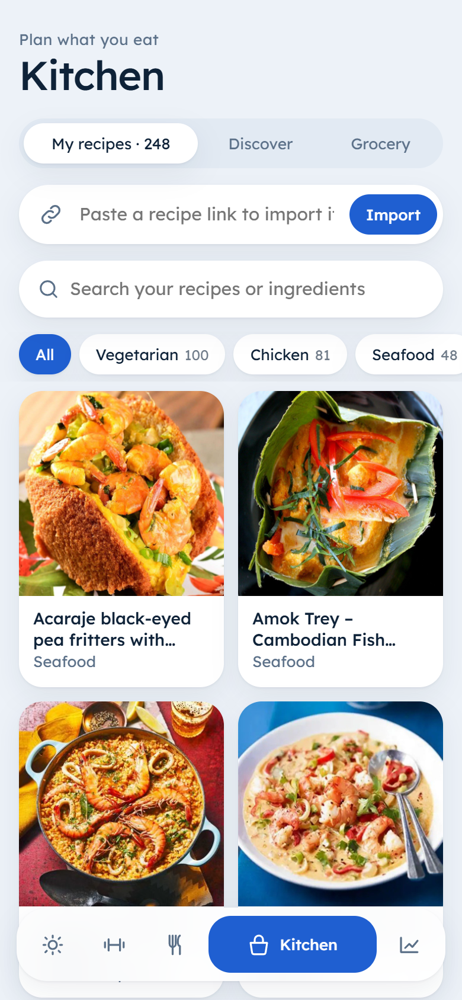 | **Kitchen.** Import 120+ starter recipes with photos in one tap, search TheMealDB, import any recipe link, log a serving, and keep a grocery list sorted by aisle. |

24 color themes, plus a custom background and accent you can save as your own.

### On a PC

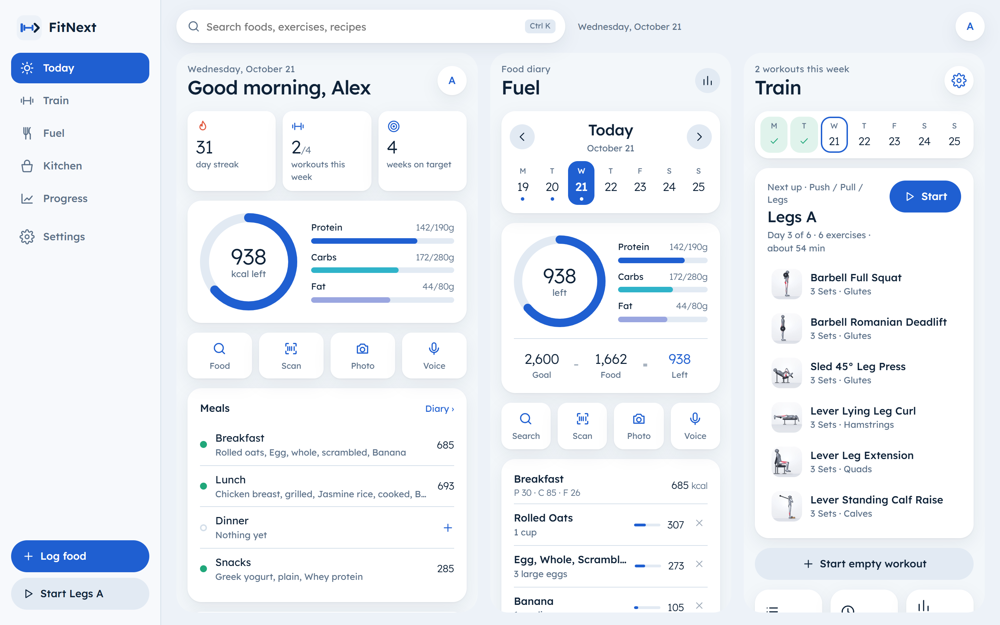
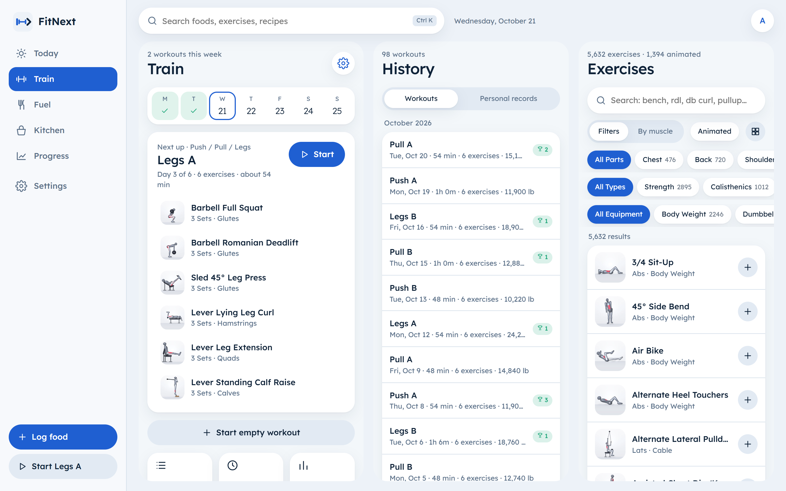
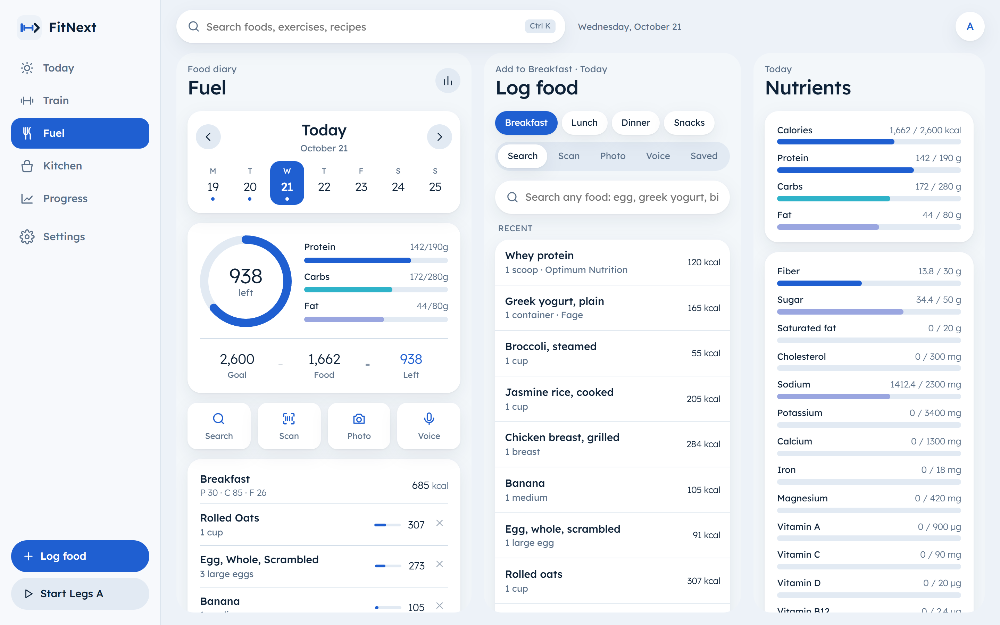
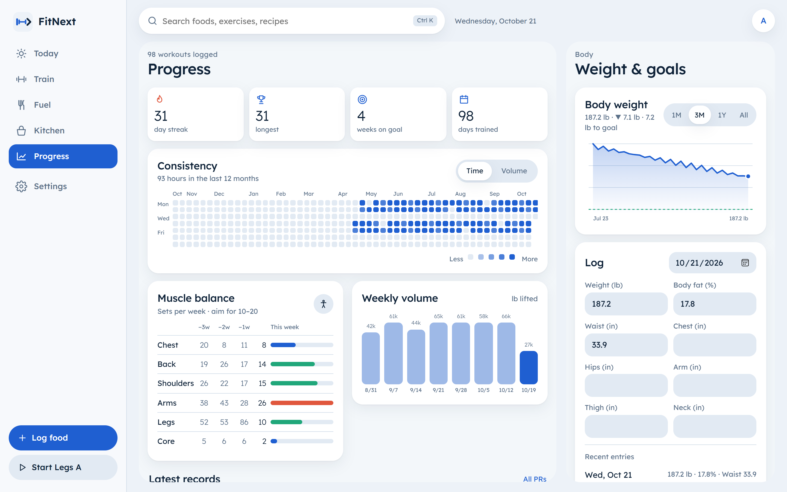
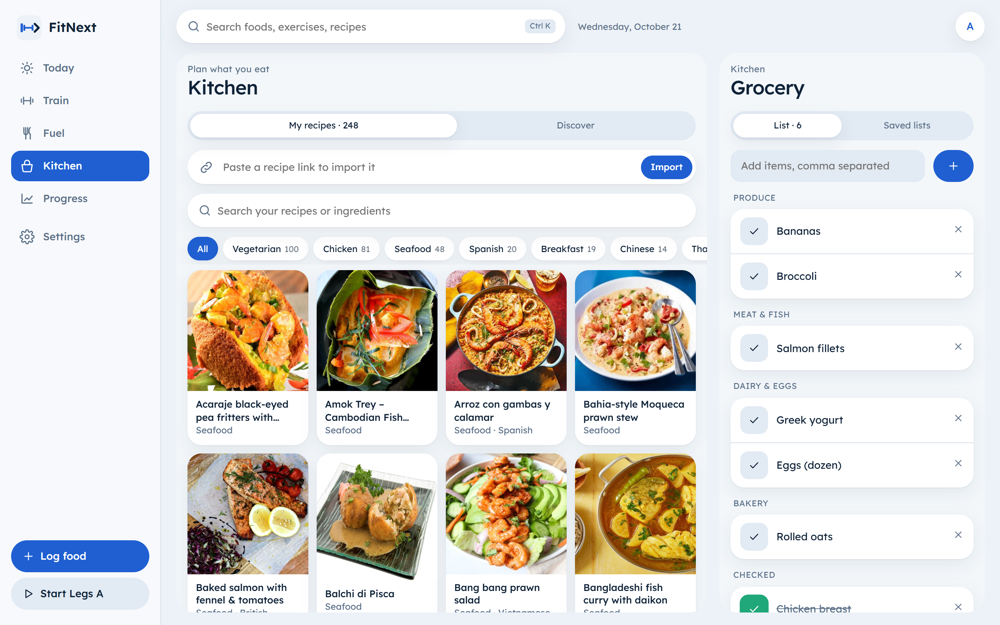

## Privacy

Your log lives on your device (localStorage in the browser, `%APPDATA%\FitNext`
on Windows). Nothing leaves it unless you turn on sync. With sync on, it's
stored as one row per user in Supabase, and row level security means each
account can read only its own row.

Food searches, barcode lookups, and photo or voice logging go through a small
API that holds the keys for the food databases and Gemini. It keeps food
search results in memory for an hour to save API calls and writes nothing to
disk.

The hosted app at fitnext-one.vercel.app runs on free API tiers. If food
search starts hitting rate limits, run your own copy (below) with your own keys.

## Build it yourself

You need Node 20 or newer.

```bash
npm install
cp .env.example .env    # fill in whichever keys you have
npm run proxy           # API proxy on :8797
npm run dev             # app on :5180
```

Every key is optional. With none, Open Food Facts search and barcode still
work, and USDA works with `DEMO_KEY` (rate-limited; a free key takes a minute
at https://fdc.nal.usda.gov/api-key-signup). Sources without a key show as
disabled in the app.

| Variable | Free tier | Used for |
| --- | --- | --- |
| `USDA_API_KEY` | free, 1,000 requests/hour | generic and branded foods |
| `FATSECRET_CLIENT_ID`, `FATSECRET_CLIENT_SECRET` | Basic edition with a free account | food search, barcode |
| `EDAMAM_APP_ID`, `EDAMAM_APP_KEY` | none: $14/month after a 30-day trial | food search, barcode |
| `SPOONACULAR_API_KEY` | 50 points/day | recipes |
| `GEMINI_API_KEY`, `GEMINI_MODEL` | Gemini API free tier | photo and voice logging |
| `VITE_SUPABASE_URL`, `VITE_SUPABASE_ANON_KEY` | Supabase free project | sync |

### Windows app

```bash
npm run desktop      # release/win-unpacked/FitNext.exe and a desktop shortcut
npm run app          # build and open the window from source, no exe
npm run installer    # release/FitNext-Setup-<version>.exe
npm run release      # the same, uploaded to this repo's releases (needs GH_TOKEN)
```

The exe runs the app and the API proxy in one process, so no browser opens and
no server needs starting. It reads keys from the first `.env` it finds:
`FITNEXT_ENV`, beside the exe, this folder, then `%APPDATA%\FitNext\.env`.
Close the app before rebuilding, since Windows won't overwrite a running exe.
Bump `version` in package.json before each release, or installed copies won't
see the update.

### Host the web app (Vercel)

`vercel.json` builds `dist/` and serves `api/index.mjs`, which runs the same
API as the local proxy.

1. Make a free Hobby account at https://vercel.com/signup and run `npx vercel login`.
2. `npx vercel` links the folder to a new project. `.vercelignore` keeps `.env`
   and the native folders out of the upload.
3. Add every key from `.env` under the project's Settings > Environment
   Variables (the `VITE_SUPABASE_*` pair too, since Vercel builds the app),
   then `npx vercel --prod`.

Anyone with your URL can use the API keys behind it, so share it with care.

### Sync (Supabase)

1. Create a free project at https://supabase.com/dashboard.
2. SQL Editor > New query: paste `supabase/schema.sql` and run it.
3. Project Settings > API: copy the Project URL and the anon public key into
   `.env` as `VITE_SUPABASE_URL` and `VITE_SUPABASE_ANON_KEY`, and into Vercel
   for the hosted app.
4. Rebuild.

The anon key is public by design. Row level security limits each user to
their own row.

### Android and iOS

`android/` and `ios/` are Capacitor projects around the same build. There is no
APK or store listing yet; the hosted web app covers phones for now.

```bash
npm run mobile            # icons, vite build, copy into android/ and ios/
npx cap open android      # Android Studio: run on a phone, or Build > Build APK
npx cap open ios          # on a Mac with Xcode
```

Set `VITE_API_BASE` in `.env` to your hosted API before `npm run mobile`,
since a phone has no local proxy.

### Rebuild the exercise catalog

```bash
node scripts/build-catalogue.mjs <openGym>/catalogue <open-exercise-figures>/exercises.json
```

## Stack

React 19, Vite and zustand in the app. Electron for Windows, Capacitor for
Android and iOS, a service worker for the installable web app. A small Node API
(`server/proxy.mjs` locally, `api/index.mjs` on Vercel) shares one handler.
Supabase for sync.

## License

AGPL-3.0-or-later. See [NOTICE.md](NOTICE.md) for the exercise data,
animations, body map and food data sources, and their licenses.
